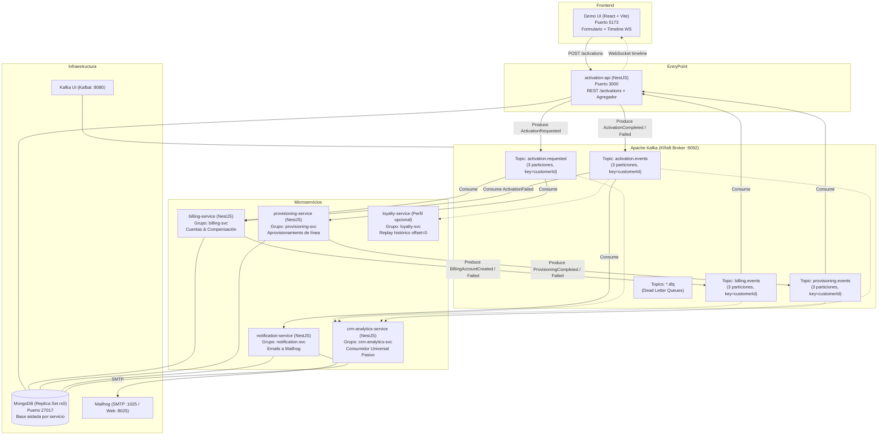
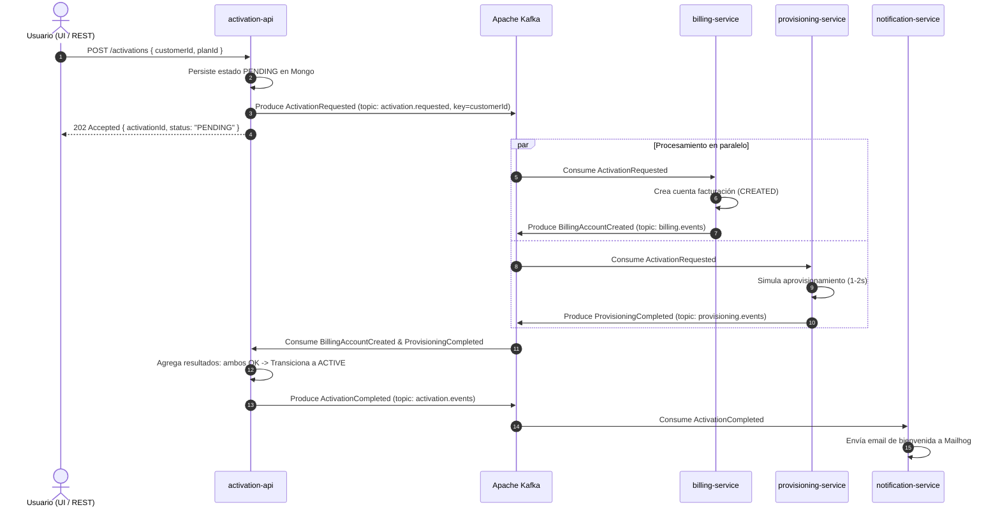
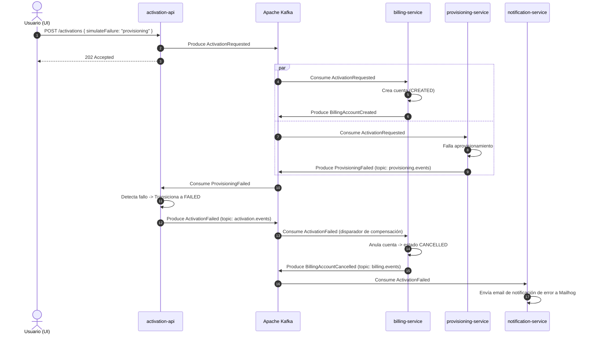
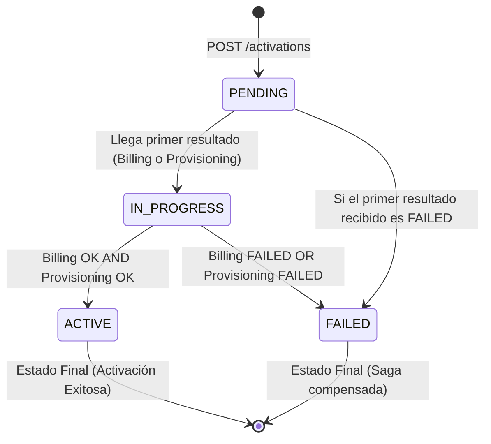

# Arquitectura Integral: POC Activación de Servicios con Kafka

> **Institución**: UTN FRCU — Ingeniería en Sistemas de Información  
> **Cátedra**: Sistemas Distribuidos (2026)  
> **Patrón Central**: Coreografía con Agregador + Saga Compensatoria + Particionado Semántico

---

## 1. Topología del Sistema y Componentes

El sistema se compone de 7 componentes desacoplados que interactúan exclusivamente a través de Apache Kafka (modo KRaft) y MongoDB (Replica Set para soporte de transacciones e idempotencia).



---

## 2. Diagramas de Secuencia

### 2.1. Camino Feliz (Fan-out y Agregación Concurrente)


### 2.2. Fallo de Negocio y Compensación en Saga (Sin RPC)


---

## 3. Máquina de Estados de la Activación



---

## 4. Sobre Común de Eventos (`EventEnvelope`)

Todos los eventos comparten la misma estructura externa; el atributo `payload` contiene los datos específicos del hecho de dominio:

```json
{
  "eventId": "7c9e6679-7425-40de-944b-e07fc1f90ae7",
  "eventType": "ActivationRequested",
  "version": 1,
  "occurredAt": "2026-09-27T16:40:00Z",
  "correlationId": "act-mvleajlr-10xd",
  "customerId": "C-1234",
  "source": "activation-api",
  "payload": {
    "planId": "FIBRA-1000MB",
    "channel": "web",
    "simulateFailure": "none"
  }
}
```

### Justificación de Atributos:
- `eventId`: UUID único fundamental para la deduplicación e **idempotencia**.
- `customerId`: Clave semántica de particionamiento. Asegura que todos los eventos del cliente viajen a la misma partición y sean consumidos en estricto orden cronológico.
- `correlationId`: Identificador del proceso de negocio (`activationId`). Permite trazar la saga de punta a punta.
- `version`: Facilita la evolución de contratos (*schema evolution*) sin romper consumidores existentes.

---

## 5. Estrategia de Idempotencia y Tolerancia a Fallos

1. **Idempotencia en Consumidores**:
   - Cada servicio cuenta con una colección `processed_events` con índice único sobre `eventId` y un TTL de 7 días.
   - Si Kafka reenvía un mensaje por rebalanceo o caída transitoria, el consumidor detecta el duplicado (`duplicate key`), descarta el efecto secundario y confirma el offset.
2. **Separación de Fallos de Negocio vs. Fallos Técnicos**:
   - **Fallo de Negocio**: Es parte del dominio. Se publica un evento (`ProvisioningFailed`, `BillingFailed`), la saga transiciona a `FAILED` y se ejecuta la compensación.
   - **Fallo Técnico** (BD inaccesible, red caída, parse error): Se reintenta 3 veces con backoff exponencial/lineal (1s, 2s, 4s). Al agotar reintentos, el mensaje se despacha al topic `<topic>.dlq` con los headers de error y se commitea el offset para **no bloquear la partición**.
