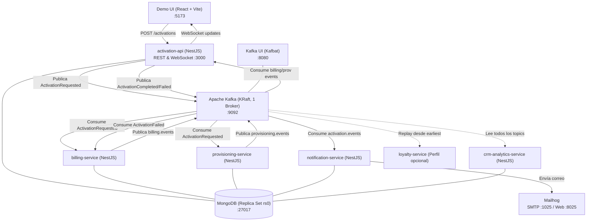
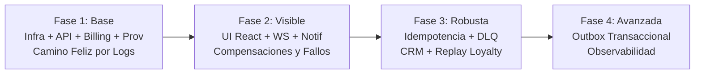

# Plan de Construcción y Análisis de Arquitectura: POC Activación de Servicios con Kafka

> **Contexto Académico / Profesional**: UTN FRCU — Sistemas Distribuidos (2026)  
> **Objetivo**: Demostrar la activación de un plan coordinada exclusivamente mediante eventos en Apache Kafka, sin acoplamiento punto a punto (RPC/HTTP) entre servicios de negocio, implementando coreografía con agregador, sagas compensatorias, idempotencia y DLQ.

---

## 1. Análisis Técnico y Arquitectónico

### 1.1. Evaluación del Enfoque
El diseño propuesto en el documento es **técnicamente sólido** y aborda con precisión los desafíos fundamentales de los sistemas distribuidos:

1. **Coreografía con Agregador (Saga Híbrida)**:
   - Evita un orquestador rígido que dé órdenes imperativas.
   - `billing-service` y `provisioning-service` reaccionan de manera autónoma al evento de dominio `ActivationRequested`.
   - `activation-api` actúa como agregador de estado final para la activación, garantizando que el cliente (vía REST/WebSocket) tenga visibilidad sin comprometer el desacople de los procesadores.

2. **Garantía de Orden por Particionamiento Semántico**:
   - Usar `customerId` como clave de partición en los 4 topics garantiza que todos los eventos asociados a un cliente caigan en la misma partición y se procesen en estricto orden cronológico por consumidor (evita condiciones de carrera entre contratos y cancelaciones del mismo usuario).

3. **Manejo Riguroso de Fallos: Negocio vs. Infraestructura**:
   - **Fallo de negocio** (`simulateFailure`): Se modela como un evento de dominio (`ProvisioningFailed`, `BillingFailed`), lo que desencadena una transacción compensatoria (`BillingAccountCancelled`). No ensucia colas de reintento ni bloquea pipelines.
   - **Fallo técnico / transitorio**: Aplica reintentos exponenciales/lineales (1s, 2s, 4s) y deriva a Dead Letter Queue (`<topic>.dlq`) sin frenar el procesamiento de la partición (*head-of-line blocking* evitado).

4. **Caso Borde Crítico de la Saga (Out-of-Order Compensation)**:
   - El documento prevé con gran lucidez la condición de carrera: si `provisioning` falla rápido, `ActivationFailed` puede llegar a `billing` *antes* de que termine de persistir `BillingAccountCreated`. La compensación debe contemplar un estado previo o registrar la cancelación preemptiva para que, si el alta llega después, nazca directamente anulada.

### 1.2. Puntos Críticos y Mitigaciones en la Implementación

| Desafío / Riesgo | Mitigación Arquitectónica |
| :--- | :--- |
| **Transacciones de MongoDB requieren Replica Set** | Configurar en Docker Compose una instancia de Mongo con `--replSet rs0` y un contenedor efímero `mongo-init` que ejecute `rs.initiate()` y espere el estado primario antes de levantar los servicios. |
| **Arranque asíncrono de Kafka KRaft** | Los microservicios NestJS que usan `kafkajs` fallan si Kafka no expone el listener listo. Se implementan healthchecks en Compose (`kafka-cluster.sh` o netcat) y `depends_on: { condition: service_healthy }`. |
| **Commit Manual de Offsets en NestJS** | Por defecto, `@nestjs/microservices` puede auto-commitear. Para cumplir RNF-03 (idempotencia y commit post-procesamiento), se debe extraer el `KafkaContext`, desactivar autoCommit si aplica, y asegurar el commit manual luego de guardar en `processed_events`. |
| **Aislamiento en Monorepo** | Usar la estructura oficial de Monorepo de NestJS (`apps/` y `libs/` compartidas con path mappings en TypeScript) para mantener los contratos (`libs/contracts`) y utilitarios (`libs/kafka-toolkit`) en un único source of truth sin publicaciones en npm. |

---

## 2. Mapa de Arquitectura y Topología

### Topología de Topics (3 particiones por topic, key = `customerId`)
1. `activation.requested` -> Eventos de solicitud de alta.
2. `billing.events` -> `BillingAccountCreated`, `BillingFailed`, `BillingAccountCancelled`.
3. `provisioning.events` -> `ProvisioningCompleted`, `ProvisioningFailed`.
4. `activation.events` -> `ActivationCompleted`, `ActivationFailed`.
5. `*.dlq` -> Mensajes técnicos irrecuperables tras 3 reintentos.

---

## 3. Plan de Construcción Paso a Paso

El plan se organiza en 4 fases incrementales, garantizando puntos de control funcionales y verificables desde el primer hito.

### Fase 1: Cimientos de Infraestructura y Flujo Base (Backend Core)
**Criterio de cierre**: RF-01 a RF-05 funcionando en consola; alta procesada de punta a punta.

1. **Setup del Monorepo**:
   - Inicializar monorepo NestJS con `nest-cli.json` configurado para `apps/` y `libs/`.
   - Crear librería compartida `libs/contracts`:
     - Interfaz genérica `EventEnvelope<T>` con `eventId`, `eventType`, `version`, `occurredAt`, `correlationId`, `customerId`, `source`, `payload`.
     - Definición de tipos y enumeradores para los 4 topics y sus payloads.
     - Constantes de nombres de topics y consumer groups.
2. **Entorno Docker Inicial (`docker-compose.yml`)**:
   - Kafka en modo KRaft (imagen `apache/kafka:latest`).
   - Servicio `kafka-init` con script `create-topics.sh` para crear los 4 topics con 3 particiones y factor de replicación 1.
   - Kafka UI (`kafbat/kafka-ui`) en puerto 8080.
   - MongoDB configurado como replica set (`mongo:7.0` con script de inicialización `rs.initiate()`).
3. **Servicio `activation-api`**:
   - Endpoints REST `POST /activations` (responde 202 con `activationId` y estado `PENDING`) y `GET /activations/:id`.
   - Publicación de `ActivationRequested` en Kafka con key = `customerId`.
   - Esquema Mongoose para `activations` con control de estados (`PENDING` -> `IN_PROGRESS` -> `ACTIVE`).
4. **Servicios `billing-service` y `provisioning-service`**:
   - Configuración de microservicio NestJS con transporte Kafka.
   - Consumo concurrente de `activation.requested`.
   - `billing`: crea registro simulado y publica `BillingAccountCreated`.
   - `provisioning`: introduce delay artificial (1 a 3 seg) y publica `ProvisioningCompleted`.
5. **Agregación en `activation-api`**:
   - Consumir `billing.events` y `provisioning.events`.
   - Cuando ambos confirman éxito -> actualiza MongoDB a `ACTIVE` y publica `ActivationCompleted`.

---

### Fase 2: Visibilidad en Vivo y Manejo de Compensación (Demo Presentable)
**Criterio de cierre**: Escenarios 1 y 2 del guion ejecutables de punta a punta desde la UI y Mailhog.

1. **Notificaciones y Mailhog**:
   - Agregar Mailhog al `docker-compose.yml` (puertos 1025 y 8025).
   - Crear `apps/notification-service`:
     - Consume `activation.events`.
     - Envía email de bienvenida ante `ActivationCompleted` y email de aviso ante `ActivationFailed`.
     - Guarda registro en colección `notifications`.
2. **Lógica de Fallo Forzado y Compensación (Saga)**:
   - Pasar `simulateFailure` ('billing' | 'provisioning' | 'none') en el payload.
   - En `provisioning`: si viene `'provisioning'`, publica `ProvisioningFailed`.
   - En `billing`: si viene `'billing'`, publica `BillingFailed`.
   - En `activation-api`: al recibir el primer fallo, pasa activación a `FAILED`, publica `ActivationFailed`.
   - En `billing`: reacciona a `ActivationFailed` y ejecuta compensación (pasa cuenta a `CANCELLED` y publica `BillingAccountCancelled`). Manejar caso carrera (si la orden aún no existía en Mongo, marcar tombstone/anticipado).
3. **Frontend `demo-ui` (React + Vite)**:
   - Formulario de contratación: input `customerId`, selector `planId`, selector `simulateFailure`.
   - Integración WebSocket en tiempo real con `activation-api` (@WebSocketGateway).
   - Timeline reactivo con transiciones de color por evento (verde = OK, rojo = fallo, azul = compensación).
   - Enlace directo a Mailhog y Kafka UI.

---

### Fase 3: Resiliencia, Idempotencia, DLQ y Replay (Enterprise Readiness)
**Criterio de cierre**: Escenarios 3, 4 y 5 completados sin duplicados ni particiones bloqueadas.

1. **Librería `libs/kafka-toolkit`**:
   - **Idempotencia**: Interceptor / helper que inserta `eventId` en la colección `processed_events` con índice único y TTL de 7 días. Si hay colisión de índice (`E11000`), descarta el procesamiento y commitea offset.
   - **Reintentos y DLQ**: Decorador o wrapper para reintentar 3 veces con backoff progresivo (1s, 2s, 4s). Al fallar el 3er intento, produce a `<topic>.dlq` con stacktrace/error en headers de Kafka y permite commitear para desatascar la partición.
2. **Servicio `crm-analytics-service`**:
   - Consume todos los topics (`activation.requested`, `billing.events`, `provisioning.events`, `activation.events`).
   - Persiste cada evento en `event_log` con `eventId` único y `correlationId`.
   - Demuestra desacoplamiento total (añadir consumidores sin modificar productores).
3. **Servicio `loyalty-service` (Escenario 5)**:
   - Definido con perfil `--profile loyalty` en Docker Compose.
   - Configurado con un nuevo `consumer-group` y `auto.offset.reset: 'earliest'`.
   - Demuestra el replay histórico procesando eventos pasados desde el offset 0.

---

### Fase 4: Outbox Transaccional y Observabilidad (Evolución a Producción / Piloto)
**Criterio de cierre**: Tolerancia ante caída de `activation-api` inmediatamente después del guardado en base de datos.

1. **Patrón Transaccional Outbox**:
   - Crear colección `outbox` (`_id`, `aggregateId`, `eventType`, `payload`, `status: 'PENDING' | 'SENT'`, `createdAt`).
   - Modificar `activation-api`: persistir la activación y el evento en `outbox` dentro de una sesión transaccional de MongoDB (`session.withTransaction`).
   - Implementar worker background (polling cada 500ms o Mongo Change Streams) que lee `outbox`, publica en Kafka y marca como `SENT`.
2. **Documentación Final y Script de Demo**:
   - Documento `docs/architecture.md` con decisiones y justificaciones.
   - Documento `docs/demo-script.md` con los comandos exactos para ejecutar los 5 escenarios en vivo en menos de 15 minutos.

---

## 4. Guion de Verificación de los 5 Escenarios

| # | Escenario | Procedimiento | Comportamiento Esperado en Demo UI & Kafka UI |
| :- | :--- | :--- | :--- |
| **1** | **Camino Feliz** | Contratar plan con `simulateFailure: "none"`. | Timeline en UI con 4 eventos en verde. Email de bienvenida visible en Mailhog (puerto 8025). |
| **2** | **Fallo y Compensación** | Contratar plan con `simulateFailure: "provisioning"`. | `ProvisioningFailed` en rojo -> `ActivationFailed` en rojo -> `BillingAccountCancelled` en violeta/naranja. Email de error en Mailhog. Cuenta anulada en DB. |
| **3** | **Servicio Caído (Resiliencia)** | `docker compose stop notification-service`, crear 3 activaciones, ver lag en Kafka UI, `docker compose start notification-service`. | Kafka UI muestra Consumer Lag = 3 en `activation.events`. Al restaurar el servicio, procesa los 3 mensajes pendientes sin pérdidas y llegan los 3 correos. |
| **4** | **Escalabilidad y Rebalanceo** | `docker compose up -d --scale billing-service=2`. | Kafka UI muestra las 3 particiones de `activation.requested` repartidas entre ambas instancias del consumer group `billing-svc` sin downtime. |
| **5** | **Replay de Log (Nuevo Consumidor)** | `docker compose --profile loyalty up -d loyalty-service`. | El nuevo servicio procesa el 100% del historial de contratos desde el inicio sin interactuar ni interferir con los servicios existentes. |
